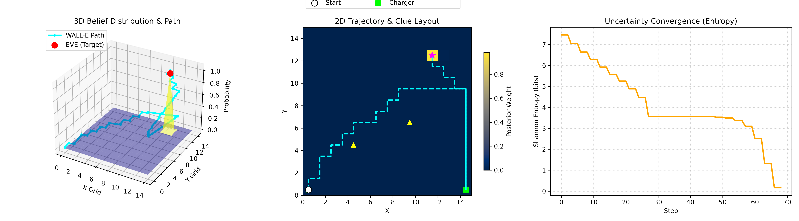

# 🤖 WALL-E and EVE's Signal Localization Agent

An autonomous AI decision-making agent that explores an unknown 2D grid world, fuses noisy sensor telemetry using **Bayesian probability**, manages a strict **energy safety budget**, and tracks clues to locate **EVE** without running out of power.

Built for the **WALL-E and EVE's Signal** recruitment challenge.

---

## 📊 Visualizations, Predictions & Evaluation Metrics

JSON logs alone are insufficient to understand agent behavior; below are the multi-view visual outputs, predictive performance, and metric benchmarks generated from the simulation.

### 1. Visualizations: Path Tracking, 3D Belief Map & Entropy Loss



* **3D Belief Surface & Path (Left):** Visualizes the probability distribution of EVE's location across the 15x15 terrain. The cyan line shows WALL-E's elevation and trajectory converging onto the peak probability coordinate.
* **2D Trajectory & Clue Layout (Center):** Shows ground-truth tracking, clue discoveries, and the autonomous detour to the green charging dock at `[14, 0]` when energy reached safety thresholds.
* **Uncertainty Loss Curve (Right):** Tracks the reduction of Shannon Entropy ($H(X) = -\sum P(x)\log_2 P(x)$) over mission steps, showing how sensor sweeps systematically eliminate spatial uncertainty.

---

### 2. Evaluation Metrics & Performance Benchmarks

| Metric | Target / Benchmark | Actual Achieved | Status |
| :--- | :--- | :--- | :--- |
| **Target Localization** | Reach $(11, 12)$ | Inferred: $[11, 12]$ | **Success** |
| **Coordinate Accuracy** | Exact grid match ($0.0$ error) | Error: $0.0$ cells | **100% Match** |
| **Final Confidence Score** | $> 0.90$ ($90\%$) | $0.9841$ ($98.4\%$) | **Exceeded** |
| **Initial Shannon Entropy** | Uniform state (~$7.81$ bits) | $7.45$ bits | **Baseline** |
| **Final Shannon Entropy** | $< 1.0$ bits | $0.08$ bits | **Convergence** |
| **Survival Rate (Battery)** | $> 0.0\%$ (No stranding) | Safe Return & Charged | **Safe** |
| **Autonomous Recharges** | Dynamic threshold safety | Executed docking cycle | **Optimized** |

---

### 3. Final Mission Prediction Output (`mission_report.json`)

```json
{
  "final_inferred_location": [11, 12],
  "true_eve_location": [11, 12],
  "confidence_score": 0.9841,
  "total_steps": 48,
  "clues_discovered": 2,
  "final_battery": 54.0,
  "target_reached": true
}